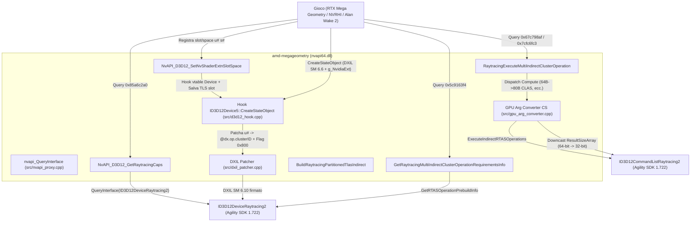

# Architettura (`amd-megageometry`)

## Stack Tecnologico
- **Linguaggio**: C++20 (MSVC `cl.exe` x64, zero dipendenze esterne oltre Windows SDK, Agility SDK 1.722 e DXC).
- **Target API**:
  - Ingresso: NVIDIA **NvAPI R570+** (`nvapi_QueryInterface`) + estensioni HLSL `nvHLSLExtns.h` (fake UAV doorbell `g_NvidiaExt`).
  - Uscita: Microsoft **DirectX 12 Agility SDK 1.722.0-preview** (`ID3D12DeviceRaytracing2`, `ID3D12CommandListRaytracing2`, Shader Model 6.10).

## Layout del Repository

```text
amd-megageometry/
├── .agent/
│   ├── agent.md              # Entrypoint documentazione e troubleshooting
│   ├── architecture.md       # Stack, flusso dati e mappa dei moduli
│   ├── deploy.md             # Setup SDK, compilazione e installazione nei giochi
│   └── translation.md        # Specifiche binarie NvAPI <-> DXR 1.722 e DXIL opcodes
├── include/
│   └── amd_mg.h              # Strutture interne condivise, stato globale, logger e interfacce
├── src/
│   ├── nvapi_proxy.cpp       # Tabella nvapi_QueryInterface e traduzione host NvAPI -> D3D12Raytracing2
│   ├── d3d12_hook.cpp        # Hook vtable ID3D12Device5::CreateStateObject e attivazione D3D12RaytracingPreview
│   ├── dxil_patcher.cpp      # Patcher DXIL (nvHLSLExtns opcodes 86, 93..99 -> SM 6.10 cluster intrinsics)
│   ├── gpu_arg_converter.cpp # Pipeline Compute D3D12 per convertire i buffer indiretti GPU NvAPI -> DXR
│   ├── cmdlist_state.cpp     # Shadow dello stato compute delle command list del gioco + ripristino dopo il convertitore
│   └── dllmain.cpp           # Entrypoint DLL e export nvapi_QueryInterface
├── shaders/
│   └── arg_converter.hlsl    # Compute shader (5 entry-point) per conversione argomenti indiretti e ResultSizeArray
├── scripts/
│   ├── repro_compiler_crash.ps1 # Crash di amdxc64 in CreateStateObject (timer costante, libreria estratta da RTXMG)
│   └── repro_null_dst_hang.ps1  # Hang GPU con destinazione nulla (AMD_MG_SANITIZE_DST=0)
├── tests/
│   ├── test_wrapper.cpp      # Test suite completa: NvAPI query, struct translation, DXIL patching, GPU converter
│   ├── run_tests.ps1         # Suite in sequenza (test_wrapper, repro sintetici, cattura+replay)
│   ├── repro_templates.cpp   # Template/istanze/BLAS sintetici tramite il wrapper
│   ├── replay_capture.cpp    # Replay offline dei dati catturati con AMD_MG_CAPTURE_REAL
│   ├── repro_rtpso.cpp       # Compila una libreria DXIL in RTPSO fuori dal gioco (SEH sui crash del driver)
│   ├── dxil_asm.cpp          # .ll -> container DXIL validato e firmato
│   └── patch_dxil.cpp        # Patcher DXIL del wrapper su un file
└── build.ps1                 # Script di build automatico (shader + nvapi64.dll + test_wrapper.exe)
```

## Flusso Dati End-to-End



## File Chiave Commentati
- [include/amd_mg.h](../include/amd_mg.h) — Definisce lo stato globale del wrapper, le strutture argomento indiretto lato host/GPU per NvAPI e DXR 1.722, e le firme interne tra moduli.
- [src/nvapi_proxy.cpp](../src/nvapi_proxy.cpp) — Espone `nvapi_QueryInterface` e traduce i parametri host delle chiamate Cluster e Partitioned TLAS verso `ID3D12DeviceRaytracing2` e `ID3D12CommandListRaytracing2`.
- [src/dxil_patcher.cpp](../src/dxil_patcher.cpp) — Usa `dxcompiler.dll` (`IDxcCompiler3::Disassemble` + `IDxcAssembler::AssembleToContainer`) e `dxil.dll` (`IDxcValidator::Validate`) per riscrivere i blocchi LLVM IR `rawBufferStore` + `bufferUpdateCounter` generati da `nvHLSLExtns.h` nelle intrinseche standard SM 6.10 (`@dx.op.clusterID`, `@dx.op.triangleObjectPosition.f32`, ecc.).
- [src/gpu_arg_converter.cpp](../src/gpu_arg_converter.cpp) & [shaders/arg_converter.hlsl](../shaders/arg_converter.hlsl) — Gestiscono il pool di scratch buffer GPU e i compute shader che convertono in tempo reale gli array di argomenti indiretti GPU prima di `ExecuteIndirectRTASOperations` e riducono a 32 bit l'array `ResultSizeArray` scritto a 64 bit da DXR 1.722.
- [src/d3d12_hook.cpp](../src/d3d12_hook.cpp) — Intercetta `ID3D12Device5::CreateStateObject`, inietta `D3D12_RAYTRACING_PIPELINE_FLAG_ALLOW_CLUSTERED_GEOMETRY` (`0x800`) nei subobject `D3D12_STATE_SUBOBJECT_TYPE_RAYTRACING_PIPELINE_CONFIG1` (o promuove `RAYTRACING_PIPELINE_CONFIG` a `CONFIG1`), e invoca il patcher DXIL su tutte le `D3D12_DXIL_LIBRARY_DESC`.

## Convertitore argomenti GPU: lifetime e stati
[src/gpu_arg_converter.cpp](../src/gpu_arg_converter.cpp), dal 2026-11-04:
- **Pool di slot scratch** (max 1024, ognuna è un buffer DEFAULT con dimensione arrotondata a potenze di 2 ≥ 64 KB). Ogni slot ha un marker `uint32` in un buffer READBACK mappato. `FinalizeGpuClusterResultSizes` registra `WriteBufferImmediate(MARKER_OUT)` sulla command list del gioco dopo l'ultimo uso. La slot torna libera, e può essere riusata o ricreata più grande, solo quando la CPU legge il marker. Se il tipo di coda non supporta `WriteBufferImmediate`, la slot viene rilasciata a tempo (2 s). Su RX 9070 XT il supporto c'è sia sulla coda direct sia su quella compute.
- **Stato canonico degli scratch: `UNORDERED_ACCESS`.** Gli argomenti convertiti passano a `NON_PIXEL_SHADER_RESOURCE` per `ExecuteIndirectRTASOperations` e poi tornano a UAV. Le result size (64 bit) restano UAV per l'operazione RTAS, passano a `NON_PIXEL_SHADER_RESOURCE` per il downcast e tornano a UAV.
- **Lo shader rispetta `indirectArgCount`**, cioè il conteggio scritto dalla GPU (root SRV `t1`, `g_HasCount`): sia la conversione sia il downcast toccano `min(count, maxArgCount)` elementi.
- **Contratto:** se `PrepareGpuClusterArguments` restituisce `true` bisogna chiamare `FinalizeGpuClusterResultSizes`, altrimenti le slot restano riservate.
- `test_wrapper.exe` verifica l'output GPU byte per byte rispetto al convertitore CPU e controlla che la slot venga riciclata dopo il marker.

## Dimensionamento (`GetRaytracingMultiIndirectClusterOperationRequirementsInfo`)
[src/nvapi_proxy.cpp](../src/nvapi_proxy.cpp): in `GET_SIZES` ed `EXPLICIT_DESTINATIONS` un result pari a 0 è legittimo, quindi viene rifiutata solo una risposta tutta a zero; in `IMPLICIT` serve un result > 0. Se la risposta è rifiutata il wrapper logga gli input (`GetRTASOperationPrebuildInfo rejected ...`) e riprova nell'ordine:
1. senza `ALLOW_DATA_ACCESS`;
2. con i totali alzati a `maxArgCount × limite per cluster`;
3. in modalità `IMPLICIT` (limite superiore per tutte le modalità);
4. con una query a singolo argomento moltiplicata per `maxArgCount`;
5. con un'euristica generosa (move: `maxBytesMoved`).

Sovradimensionare è innocuo; sottodimensionare fa scrivere la GPU oltre i buffer del gioco.

Osservato su RX 9070 XT con driver 32.0.32012.1013 (RTXMG ABeautifulGame). Probabilmente legittimo, non un bug: in queste modalità non si scrive nessun oggetto nel buffer risultati e lo scratch può non servire. Per questo è stato tolto dalla tabella "Driver issues" del README.
- `BUILD_CLAS_FROM_TRIANGLES` in `GET_SIZES` → tutto 0, si usa il limite IMPLICIT.
- `MOVE_CLUSTER_OBJECT` in `EXPLICIT` → tutto 0 in ogni tentativo, si usa l'euristica.

## Stato compute della command list del gioco
[src/cmdlist_state.cpp](../src/cmdlist_state.cpp), dal 2026-11-04. Il convertitore registra un dispatch con root signature e PSO propri sulla command list del gioco. NvAPI su NVIDIA non tocca lo stato, quindi un motore può continuare a usare root signature/argomenti/PSO impostati prima della chiamata cluster (nvrhi ri-binda, Northlight no → GPU crash in Alan Wake 2 alla prima operazione cluster).
- Layout del runtime 1.722 (verificato su amdxc64): una lista **aperta** usa una vtable **per-lista allocata in heap** che salta direttamente nel driver; una lista **chiusa** usa una vtable statica in `D3D12Core.dll`, e `Reset` rimette quella per-lista. Un hook "per classe" sulla vtable non basta.
- Hook: `ID3D12Device::CreateCommandList` (slot 12) e `Reset` della vtable statica chiusa (slot 10, trovata con liste sonda DIRECT/COMPUTE) ri-patchano la vtable per-lista: `SetPipelineState`, `SetPipelineState1`, `SetComputeRootSignature`, `SetComputeRoot*`, `Close`, `ClearState`, `GetType`. Gli hook sono template sull'indice del set di funzioni originali, niente lookup per chiamata.
- `ComputeStateScope` (RAII in `Impl_NvAPI_D3D12_RaytracingExecuteMultiIndirectClusterOperation`): trova la lista reale anche dietro proxy Streamline/OptiScaler (sonda `GetType()`), fotografa lo stato, sospende la registrazione durante i comandi del wrapper e alla fine ripristina root signature, argomenti e pipeline (PSO o state object).
- Liste aperte prima dell'installazione degli hook: patchate al primo uso, ma per quella registrazione non c'è stato da ripristinare (log `[State] No compute state recorded ...`).
- Test: `test_wrapper` registra uno stato "gioco", esegue il convertitore dentro lo scope e verifica con un dispatch che il valore della root constant del gioco arrivi in un UAV.

## Diagnostica cluster (2026-11-06)
- `build/repro_templates.exe` costruisce e istanzia template tramite il wrapper (`build/nvapi64.dll`) con i parametri di Alan Wake 2, una variabile alla volta: `--fmt=f32|snorm16 --idx=8|16|32 --vstride=N --gpucount --n= --inst= --hint --fasttrace --tri=N --smallsize --idxbase=N --empty=N --emptydst`. Riempie le destinazioni di zone di guardia `0xCD` e riporta i byte scritti davvero rispetto alla dimensione dichiarata dal driver.
- Risultati su RX 9070 XT, driver 26.20.12.01: formati, stride, conteggio GPU, hint, FAST_TRACE e indici assoluti nella mesh (`--idxbase=49|300`, sia `UINT8` sia `UINT16`) passano tutti senza overflow. Anche la demo RTXMG Barbarian, che usa i template, passa sia con `--cluster-api dxr` sia con `nvapi`.
- **Causa del crash GPU di Alan Wake 2 (ipotesi confermata in repro):** uno slot con **destinazione nulla** nell'array `destinationAddressArray` (modalità explicit) fa andare in hang la GPU AMD (`0x887A0006`), anche se l'argomento è vuoto (0 triangoli). Con destinazione valida lo slot vuoto è innocuo (`--empty=16` passa, `--empty=16 --emptydst` crasha). NVIDIA evidentemente salta questi slot. AW2 costruisce i template con `count = maxArgCount` (17397, nessun conteggio GPU), quindi gli slot inutilizzati arrivano al driver.
- **Fix (default attivo, `AMD_MG_SANITIZE_DST=0` lo disattiva):** in modalità explicit il convertitore copia l'array delle destinazioni in uno slot scratch (mode 10 dello shader, stride → 8) sostituendo gli indirizzi nulli con un buffer "sink" da 8 MB nello stato `RAYTRACING_ACCELERATION_STRUCTURE` ([src/gpu_arg_converter.cpp](../src/gpu_arg_converter.cpp), `EnsureNullDstSink`). DXR riceve la copia; l'array del gioco non viene toccato. **Non è un bug del driver** (verificato sulla spec [Raytracing2](https://microsoft.github.io/DirectX-Specs/d3d/Raytracing2.html) il 16/11/2026): in DXR un argomento vuoto produce comunque un oggetto vuoto ("`0` just produces an empty CLAS"), che viene scritto nella sua destinazione. L'array delle destinazioni può essere NULL solo in GET_SIZES; solo le voci di `ClasAddressArray` delle BLAS possono essere NULL e vengono ignorate. Il redirect è quindi la traduzione corretta della semantica NvAPI, non un workaround.
- **Smentito per AW2 (crash 2026-11-06 15:04):** la scansione completa non trova né destinazioni nulle né argomenti vuoti (17397 template, 33618 istanziazioni, 499 BLAS tutti validi). Il redirect resta come protezione. Il page fault non segue lo spostamento dei buffer del gioco tra due crash (buffer del gioco +0x1FC0000, fault +0x21A8000): ipotesi successiva, lettura/scrittura DXR oltre la fine di un buffer del wrapper. Per verificarla il log riporta gli intervalli VA degli slot scratch e del sink (`[Converter] scratch slot`), il DRED indica il buffer del wrapper più vicino al fault, e ogni operazione cluster è racchiusa da marker `amd_mg op#N type=T` visibili come `ctx=` nei breadcrumb.
- **Crash 2026-11-06 15:16 (marker DRED):** l'operazione in volo è la **prima istanziazione** (type 4, conteggio GPU, 33525 argomenti), subito dopo la costruzione dei 17397 template, completata. Fault `0x8e3176000`: 3,6 GB oltre l'ultimo buffer del wrapper, quindi non è un overflow dei nostri array; tutti i fault finora cadono in `0x8e1..0x8e3` senza allocazione. Le stringhe `ctx=` dei marker non vengono registrate (solo la posizione `SETMARKER`). Restano da provare in repro le caratteristiche di AW2 non ancora coperte: indirizzi distribuiti su più finestre da 4 GB (`--span`, template a hi32 0x3..0x7, CLAS a 0x7f, vertici a 0x7c), indici che collidono col trucco UINT8 (`--idxspread`), `positionTruncateBitCount=8` (`--trunc`), vertex buffer allineati a 4 byte (`--vboff`); `--aw2` le attiva tutte.
- **`repro_templates --aw2 --n=64 --inst=256` passa (2026-11-06):** nessuna di queste caratteristiche, da sola o insieme, manda in crash il driver. Differenze ancora non coperte dal repro: (1) AW2 **impacchetta** template e CLAS con dimensioni calcolate da sé (dst a distanze variabili 4,6–7,9 KB, non il massimo dichiarato) e interroga `GetClusterOperationRequirementsInfo` con `maxOps=1` per diverse combinazioni prima di costruirli, quindi un'istanza o un template può sovrapporsi a un altro; (2) gli `ib` dei template sono allineati solo a 2 byte (`align>=2^1`); (3) scala (17397 template / 33525 istanze contro 64/256).
- **Analisi layout `[Layout]`** (parte di `AMD_MG_DUMP_ARGS`, [src/gpu_arg_converter.cpp](../src/gpu_arg_converter.cpp) `RecordLayoutCapture`/`AnalyseLayoutLocked`): copia gli array **completi** di argomenti e destinazioni della prima operazione template / instantiate / BLAS (mode 11 dello shader, limitata al conteggio GPU) in un readback da 32 MB, e quando le copie sono confermate (o alla rimozione del device) riporta: destinazioni nulle/duplicate, istogramma delle distanze fra oggetti, distanza minima per fascia di triangoli, istanze il cui template **non** è un template costruito, CLAS che iniziano dentro un template o finiscono a meno di 4 KB dal successivo, BLAS dentro template/CLAS. Se il processo termina senza crash l'analisi viene stampata anche allo shutdown del convertitore (verificata con `repro_templates --aw2`: 256/256 istanze puntano a template costruiti, nessuna sovrapposizione).
- **Crash 2026-11-06 16:53 con analisi layout (AW2):** fault `0x8e3d24000`, sempre durante l'istanziazione. Tutte le 33525 istanze puntano **esattamente** a uno dei 17397 template costruiti; nessuna destinazione nulla o duplicata; nessun CLAS dentro un template. AW2 chiede la dimensione con `maxOps=1` per **ogni** combinazione tri/vtx (es. tri=38 vtx=56 → template 4864, CLAS 4864) e impacchetta con quella: distanza minima 768 byte per i template da 1–4 triangoli, 6144 per 49–64. Gli `ib` di 5394 template sono allineati solo a 2 byte. ("BLAS dst inside a CLAS=501" è un falso positivo: le BLAS stanno nello stesso pool, fra un gruppo di CLAS e il successivo.) Prossimi test repro: `--iboff=2`, `--tri=1|4 --smallsize` (cluster minuscoli con dimensione esatta), scala AW2 (`--n=17397 --inst=33525`).
- **Repro F–I passano (2026-11-06):** `--iboff=2` (ib allineati a 2 byte), `--tri=1|4 --smallsize` (il driver scrive 644/640 byte su 768 dichiarati, nessun overflow) e la scala AW2 `--n=17397 --inst=33525` (stessa coda compute di AW2). Nessuna caratteristica strutturale riproduce il crash: resta il **contenuto** di alcuni argomenti/dati reali.
- **Esecuzione a blocchi (`AMD_MG_SPLIT_OPS=N`, default 256, 0 = off):** le operazioni CLAS/template/instantiate in modalità explicit con più di N argomenti vengono eseguite come N-blocchi ([src/nvapi_proxy.cpp](../src/nvapi_proxy.cpp) loop su `chunkSize`; conteggi per blocco calcolati sulla GPU dal mode 12 dello shader; barriera UAV fra blocchi perché la scratch è condivisa). Prima/dopo ogni blocco `WriteBufferImmediate` MARKER_IN/OUT scrive `(op<<16)|(blocco+1)` in un readback: alla rimozione del device `[Split] last chunk started/completed` e, se l'operazione è quella catturata da `[Layout]`, gli argomenti del blocco in volo con i dati del template usato (`[Split]   inst …`).
- **Correzione (crash 2026-11-06 17:12, esecuzione a blocchi):** l'istanziazione **termina** (131/131 blocchi completati); l'operazione in volo è la successiva, `BUILD_BLAS_FROM_CLAS` (type 1, 501 BLAS, fino a 4458 CLAS per BLAS, non divisa). Anche i crash precedenti attribuiti all'istanziazione erano quasi certamente la BLAS (il breadcrumb `SETMARKER` non distingue i marker). Gli array di indirizzi CLAS delle BLAS puntano dentro l'array delle destinazioni dell'istanziazione (indirizzi CLAS validi). AW2 mette ogni BLAS subito prima dei propri CLAS (es. BLAS a `0x7f1400000`, primo CLAS a +768) e la dimensiona con le query `maxOps=1` per numero di CLAS (1→768, 3→1024, 7→1792 byte…). Ipotesi: il driver scrive la BLAS oltre la dimensione dichiarata e sovrascrive i CLAS che sta leggendo. Verifiche: `[Layout] BLAS room vs reported size` (spazio prima dell'oggetto successivo contro la dimensione riportata, tabella da `NoteReportedBlasSize`) e `repro_templates --blas=N` (BLAS da N CLAS con zone di guardia).
- **Test BLAS isolati (2026-11-06, J–M, tutti OK):** BLAS da 2/7/64/4458 CLAS con zone di guardia: il driver scrive al massimo la dimensione riportata (2→768/768, 7→1664/1792, 64→10752/10752, 4458→713856/713984 byte), nessuno sconfinamento. Nel test isolato l'ipotesi "BLAS che sovrascrive i CLAS" non regge; resta da vedere lo spazio che AW2 lascia davvero (`[Layout] BLAS room`).
- **Crash 2026-11-06 19:08 (crash10):** di nuovo in volo la BLAS (tra i due `SETMARKER` del wrapper, istanziazione 130/130 blocchi completati). Spazio BLAS corretto: `too small=0`, `min slack=0` (229 dimensioni riportate); il "BLAS dst inside a CLAS=498" è solo il gap dopo l'ultimo CLAS della mesh precedente, non una sovrapposizione. Differenza rimasta col test isolato: AW2 chiede **un'unica operazione da 499 BLAS di 2..4458 CLAS** (`maxClasPerArg=4458`, totale 33260, scratch riportato 4,47 MB), cioè `maxArgCount × maxClasPerArg` = 2,2 M contro i 33260 reali; i test J–M avevano BLAS tutte uguali (prodotto = totale). Risposta: `AMD_MG_SPLIT_BLAS` (default 1 BLAS per operazione) e `repro_templates --blasbig=M` (prima BLAS da M CLAS, le altre da `--blas=N`).
- **Test --blasbig (2026-11-06):** P (497 BLAS di 58 + 1 da 4458, una BLAS per operazione) OK, nessuno sconfinamento; N/O non eseguiti (GPU instabile dopo un TDR, `D3D12CreateDevice failed` e poi blocco anche del test base: dopo un crash serve spesso riavviare).
- **Crash 2026-11-06 19:22 (crash11, `AMD_MG_SPLIT_BLAS=1`):** fallisce la **prima** BLAS (chunk 0, 12 CLAS, `clasArray=0x805749c00`), quindi non è l'operazione unica da 499. Indizio: il fault è sempre a **batchScratch + ~0xE0E00000** (crash10 `0x8e18f8000` − `0x800ac0000` = `0xE0E38000`; crash11 `0x8e1bbe000` − `0x800dc0000` = `0xE0DFE000`), mentre BLAS/CLAS si spostano di centinaia di MB: il driver calcola un offset nello scratch da un valore enorme, verosimilmente letto dai CLAS. Nuova diagnostica: alla BLAS il wrapper copia l'array destinazioni dell'ultima istanziazione (dove puntano i `clasArray`) e logga `[Layout] BLAS CLAS refs read at BLAS time` (CLAS validi / non-CLAS / cambiati dopo l'istanziazione) e, per la BLAS in volo, `[Split]     clas j:` con istanza e template di ogni CLAS.
- **Crash 2026-11-08 12:16 (crash12):** CLAS letti dalle BLAS tutti validi (34144/34144, nessuno cambiato dopo l'istanziazione) → gli indirizzi sono a posto. Fault a `0xfffffffff000` (indirizzo "negativo"). BLAS in volo: la prima, 10 CLAS di una sola mesh (istanze 1136–1145, stesso vb, `cid+=0`); i template hanno tri 31..64, vtx 46..133 e **indice di geometria 0 per 5 CLAS e 1 per gli altri 5**, con ID cluster che ripartono da 0. Il test isolato ha sempre usato geometria 0 e ID distinti. Nuove opzioni `repro_templates`: `--geom=K` (template i → geometria i % K) e `--cid0` (`clusterIdOffset=0`).
- **Test S/R/Q (2026-11-08) tutti OK:** BLAS da 10 CLAS, ID cluster duplicati, geometria 0/1 mista → nessuno dei due tratti causa il crash. Ipotesi successiva: il driver assume lo **scratch azzerato** per BLAS_FROM_CLAS (nel repro lo scratch è memoria nuova; in AW2 è riusato dopo template/istanziazione, e il fault è sempre relativo allo scratch, l'ultimo a `0xfffffffff000` ≈ -1). Opzione `--scratchfill=0xNN` (riempie lo scratch prima della BLAS). **Test V/W/X (scratch a 0x00/0xCD/0xFF) tutti OK** → smentita, almeno nel repro.
- **Indici:** tutti i 7 run di AW2 (crash6–12) usavano `UINT8` (troncamento degli indici assoluti > 255 → geometria sbagliata); AW2 non è mai stato provato con `UINT16`. Dal 2026-11-08 `amd_megageometry.ini` in AW2 imposta `AMD_MG_INDEX_FORMAT=16`.
- **Crash 2026-11-08 12:41 (crash13, `UINT16` attivo da ini):** identico: fallisce **sempre la prima BLAS** (chunk 0; qui 15 CLAS di una mesh, alcuni con `geom=0x8000000N` = OPAQUE + indice N, bit uguali in NvAPI e DXR), fault `0xfffffffff000`, CLAS refs tutti validi. Il troncamento UINT8 **non** è la causa. AW2 mescola template con indici a 16 e 32 bit (`idxFmt` 2 e 4, stride esplicito dal convertitore). I log mostrano 2–3 attach per avvio: sono processi diversi (launcher/gioco), non doppio caricamento. Il fatto che fallisca sempre la prima BLAS, qualunque mesh sia, fa pensare a una causa globale (stato/scratch/memoria di AW2) o a dati reali che nessun test sintetico riproduce.
- **RGD (Radeon Developer Panel 3.5.1.13):** con AW2 lo stato Crash Analysis resta `Offline`; Output log: `DDToolConn ... The initial driver state is unexpected: 2` e `Connection (umd id ..., kmd id ...) already exists`. Nessun dump prodotto. Al secondo tentativo (chiuso Docker, pannello/servizio riavviati, AW2 aggiunto all'elenco) RGD 1.6.3 ha catturato (`Documents\rgd_dumps\AlanWake2\*.txt`): ultimo `Dispatch [Driver-PAL]` completato = dispatch interno della prima BLAS, `Barrier` successivo in corso, poi ~500 coppie Dispatch/Barrier non iniziate (gli altri chunk BLAS); fault `0x8e993c000` senza risorse associate; **nessuno shader in volo** (niente SGPR/VGPR). I marker `SetMarker` del wrapper non compaiono nell'albero (solo `[Driver-PAL]`). Nel nostro log, stesso run: prima BLAS (4 CLAS), CLAS validi.
- **Layout di AW2 nel repro:** `--pack` mette ogni BLAS (dimensione riportata, allineata a 256) subito prima dei suoi CLAS (dimensione riportata), in un unico buffer, come AW2; i controlli di guardia non hanno senso in questo layout. **Test Y/Z/AA (pack, BLAS da 4/15/16 CLAS, fino a 4096 CLAS) tutti OK** → nemmeno il layout BLAS+CLAS contiguo è la causa.
- **Stato al 2026-11-08:** il repro sintetico, con tutti i tratti noti di AW2 (formati, stride, indici assoluti 16 bit, span VA, hint, FAST_TRACE, conteggi GPU, split, BLAS miste, geometria 0/1, ID duplicati, scratch sporco, layout contiguo), **non** crasha; AW2 crasha sempre alla prima BLAS. Restano: (a) i dati reali dei CLAS (geometria/indici veri), (b) l'ambiente di AW2 (scratch del gioco, memoria, stato). Prossimo A/B proposto: sostituire nel wrapper i CLAS delle BLAS con un CLAS sintetico costruito dal wrapper (se non crasha → dati), e/o scratch privato del wrapper per le BLAS (se non crasha → scratch del gioco). Implementati come `AMD_MG_BLAS_FAKE_CLAS` / `AMD_MG_BLAS_PRIVATE_SCRATCH` (vedi [agent.md](agent.md)), verificati nel repro (AB1/AB2 OK).
- **Crash 2026-11-08 15:50 (crash15, scratch privato 4,39 MB):** il crash **si sposta**: chunk 0–4 completati, fallisce la BLAS 5 (6 CLAS, geometrie 0x0/0x80000001/0x80000002), fault `0x8a673c000`. Con lo scratch del gioco falliva sempre la BLAS 0 → probabilmente due problemi: lo scratch di AW2 (troppo piccolo o condiviso) e qualcosa nei CLAS di alcune BLAS. In tutte le BLAS fallite finora compaiono CLAS con indice di geometria ≥ 1. Prossimo run: scratch privato + CLAS finto insieme; il log ora riassume anche le 16 BLAS completate prima di quella in volo (`[Split]   done blas`).
- **Crash 2026-11-08 15:58 (crash16, scratch privato + CLAS finto):** **tutte le 501 BLAS completate**; il crash passa a un `DISPATCHRAYS` sulla coda Direct (list #24, 778/1234), fault `0xbeefdeadc000` (valore segnaposto non nostro), crash lieve (scatto di ~2 s, niente blocco). Con CLAS finti tutti i cluster hanno ID/geometria/primitiva 0: probabile effetto collaterale negli shader del gioco. Conclusione: **sono i CLAS veri di alcune BLAS a far fallire BLAS_FROM_CLAS**. Sospetto: indice di geometria ≥ 1 (presente in tutte le BLAS fallite). Prossimo run: scratch privato + `AMD_MG_FORCE_GEOM0=1`.
- **Crash 2026-11-08 16:09 (crash17, scratch privato + geometria forzata a 0):** passano 4 BLAS (anche quella da 1064 CLAS), fallisce la BLAS 4 (11 CLAS); blocco totale. **L'indice di geometria non è la causa.** Nuova ipotesi: in AW2 il `vertexBuffer` del template (hint, es. `0x7c214c3fc`) è un buffer diverso da quello dell'istanza (`0x7c23683d8`), mentre nel repro le posizioni di hint e istanze sono quasi identiche (stessa griglia). Se il driver dimensiona la quantizzazione/compressione sulle posizioni hint, posizioni d'istanza diverse darebbero CLAS corrotti. Repro: `--instscale=S` (istanze = griglia × S + offset) e `--instrand` (istanze casuali in [-1,1]); wrapper: `AMD_MG_TEMPLATE_NO_HINT=1`. **Test HA/HB (`--instscale=1.8`, `--instrand`) OK** → la differenza hint/istanza non riproduce il crash (CLAS scritti sempre 4096 byte). Ipotesi successiva: AW2 dichiara per cluster meno vertici unici di quelli che gli indici usano davvero (es. vertici di bordo condivisi): repro `--vtxdecl=N` (dichiarati N, usati 3×tri). **Test VD1/VD2 (180 e 96 dichiarati su 192 usati) OK** → nemmeno questo.
- **Stato al 2026-11-08 sera:** con dati sintetici il repro non crasha in nessuna variante; in AW2 crasha sempre qualche BLAS (indice 0, 4, 5 secondo il run) costruita sui CLAS veri, mentre con il CLAS finto passano tutte. La causa è nei dati reali dei CLAS (o nel modo in cui AW2 li produce) e non è uno dei tratti noti. Restano: cattura dei dati reali (index/vertex buffer dei cluster delle prime BLAS, via ExecuteIndirect con root SRV dal GPU) e replay nel repro; oppure segnalazione ad AMD con il dump RGD.
- **Cattura dati reali (2026-11-08):** `AMD_MG_CAPTURE_REAL` ([agent.md](agent.md)) + [tests/replay_capture.cpp](../tests/replay_capture.cpp). Formato del file e significato dei record descritti in testa a `replay_capture.cpp`. Il replay ricostruisce template (indici e hint ribasati su un buffer upload), istanze (vb ribasato in modo che `vb + idx*stride` cada nella finestra catturata) e BLAS, con gli input NvAPI originali del gioco. Gotcha: nella command signature le **costanti root devono precedere** i descrittori SRV/UAV root (altrimenti `CreateCommandSignature` → `E_INVALIDARG`); comando da 64 B = costanti(7) + SRV + UAV + dispatch + pad (`WriteCopyCmd` nello shader). Verificato sul repro (4 BLAS, 40 CLAS catturati e ricostruiti, replay OK).
- Le query `GetClusterOperationRequirementsInfo` ora loggano anche tri/vtx/totali/trunc.
- Dump `[Dump]`: oltre ai primi 64 argomenti, una scansione GPU di **tutti** gli argomenti (righe `scan:`: slot vuoti, puntatori nulli, formati non validi, indici degli slot anomali, intervallo e allineamento dei puntatori) e dell'array delle destinazioni (`scan dst:` con il numero di destinazioni nulle). Modi 7/8/9 dello shader, prime 3 operazioni per tipo.
- Chiusura del processo: `D3D12Core.dll` viene scaricata prima del wrapper, quindi al `DLL_PROCESS_DETACH` di `ExitProcess` gli oggetti D3D12 del convertitore vengono lasciati in memoria invece di essere rilasciati (prima l'uscita dava `0xC0000409`).
- Un buffer nello stato `RAYTRACING_ACCELERATION_STRUCTURE` non può essere portato in un altro stato: il core runtime rimuove il device con `0x887A0001`.

## Limiti noti
- **`IndexFormat` dichiarato sempre `UINT8`:** in NvAPI il formato degli indici è un campo per argomento sulla GPU (bitfield `indexFormat`, bit 24..27), in DXR è nel descrittore lato CPU. Il wrapper dichiara `UINT8` e il convertitore rende esplicito lo stride (NvAPI `indexBufferStride=0` → 1/2/4 byte secondo `indexFormat`). Gli indici di un cluster sono locali (< 256), quindi leggere il byte basso di un indice a 16/32 bit con lo stride giusto dà il valore corretto (little endian). Se un driver ignorasse lo stride con `UINT8` servirebbe un passaggio di riscrittura degli indici. **Smentito da Alan Wake 2 (dump 2026-11-06):** più cluster della stessa mesh condividono lo stesso `vertexBuffer` (anche in instantiate) e gli indici a 16 bit sono assoluti nella mesh, quindi ≥ `vertexCount` e potenzialmente > 255. In repro gli indici assoluti **non** causano crash (la causa era la destinazione nulla, vedi sopra), ma con `UINT8` gli indici > 255 vengono troncati e la geometria è sbagliata: `AMD_MG_INDEX_FORMAT=16` dichiara `UINT16` (corretto per AW2, sbagliato per giochi con indici a 8 bit).
- **`addressResolutionFlags` indiretti** (array di argomenti, conteggio, size): il convertitore li tratta come indirizzi diretti e lo segnala una volta nel log.
- **Una command list ri-eseguita senza essere ri-registrata** può leggere slot già riassegnate dopo la prima esecuzione (RTXMG ri-registra a ogni frame).
